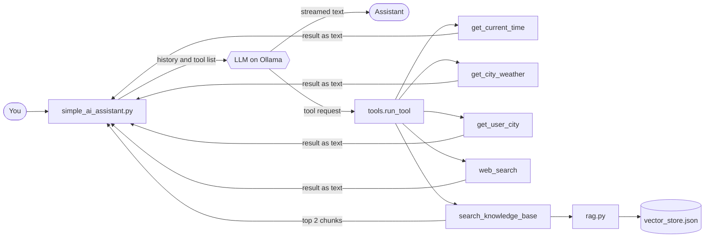

<div align="center">


**A terminal AI assistant that runs fully on your own machine. It streams its replies, calls tools, chains them, and answers company questions from your own documents (RAG), with no paid API key and no agent framework.**

</div>

<br/>

## 🚀 What is this?

A **local AI assistant built from scratch in Python**. It talks to a model running on [Ollama](https://ollama.com) through the OpenAI-compatible API, so all the logic is plain Python you can read.

It remembers the conversation, follows a system prompt, streams the answer token by token, and can use tools **in several steps**. For example, it can search the web, read the results, and then answer with source links.

It can also **answer from your own documents (RAG)**: it searches a small knowledge base, answers only from what it finds, cites the source, and says so when the documents do not contain the answer.

> 🎬 I am building this while learning from the **Advanced AI** playlist by [codestorywithMIK](https://www.youtube.com/@codestorywithMIK). The core ideas (a tool-calling agent loop on Ollama and a RAG pipeline) follow that series, and I have extended them with streaming, web search and Ctrl+C handling. See [Acknowledgements](#-acknowledgements).

> [!NOTE]
> 🌱 **Work in progress.** RAG is already inside the agent, and a standalone Chroma example shows how a vector database would replace the JSON store. Next on the list: persistent chat memory and more tools.

<br/>

## ✨ Features

| | Feature | Details |
|---|---|---|
| 🌊 | **Streaming replies** | Text appears token by token instead of after a long wait |
| 🧩 | **Streamed tool-call assembly** | Tool names and arguments arrive in small pieces and are stitched together before running, including several tool calls in one step |
| 🧠 | **Conversation memory** | The full history is sent on every call, because the model has no memory of its own |
| 🎭 | **System prompt routing** | Tells the model when to answer directly, when to use a utility tool, when to search the knowledge base, and when to search the web |
| 🔧 | **Tool calling** | Tools are described with a JSON schema and executed by our own code |
| 📝 | **Required parameters** | `get_city_weather` needs a `city`, declared in the schema |
| 🔗 | **Chained tool calls** | A loop with a step limit (`MAX_STEPS = 5`) so it can never run forever |
| 🚧 | **Step-limit fallback** | If there is no final answer after `MAX_STEPS`, you get a clear "could not finish" message instead of a hang |
| 🛡️ | **Safe errors** | Tool failures go back to the model as text, so the program does not crash |
| ⏹️ | **Stop with Ctrl+C** | Press `Ctrl+C` while the assistant is answering to stop the stream. That turn is removed from the history, so the next question starts clean |
| 🌐 | **Web search** | `web_search` uses DuckDuckGo and returns the top 5 results with URLs |
| 📚 | **Agentic RAG** | The model decides when to call `search_knowledge_base`. Our code runs the search, so the model never touches the vector store |
| ✂️ | **Chunking with metadata** | Each document is split at blank lines, one section per chunk, with the heading kept inside. Every chunk carries a `source` and a `chunk_id` |
| 💾 | **Saved vector store** | Chunks are embedded once and saved to a JSON file, so later starts load instantly with no re-embedding |
| 📎 | **Grounded answers with citations** | Company answers come only from the retrieved text, with a source like `(leave_policy.txt #3)` |
| 🧪 | **Chroma example** | A standalone script in `Code_Snippets/` shows a vector database with our own embeddings and persistence. Not wired into the assistant |
| 🪲 | **Debug trace** | Grey step-by-step logs, switched on with `DEBUG=True` |

<br/>

## 🧩 How it works

The model **never runs code**. It only asks for a tool. Our Python code runs it, sends the result back, and the loop repeats until the model answers in plain text.



<details>
<summary><b>📖 The loop in words (click to expand)</b></summary>

1. We send the conversation plus the list of tools to the model.
2. The reply streams in. Text is printed live, and any tool request is collected piece by piece until it is complete.
3. Our code runs the real function and sends the result back with the `tool` role.
4. The model reads the result and either asks for another tool or writes the final answer.

This repeats up to `MAX_STEPS` times per question. If the limit is reached, the assistant says so instead of looping forever.

</details>

> ⚡ **Streaming:** each call to the model is made with `stream=True`. Text is printed as soon as it arrives, while any tool request is collected piece by piece and run only after the stream ends.

<br/>

## 📚 How RAG works here

RAG (Retrieval-Augmented Generation) means: **find the relevant text from our own data first, and give it to the model, so it answers from that text.** Three workers do three different jobs:

| Worker | Job |
|---|---|
| **Embedding model** (for example `nomic-embed-text`) | Turns text into vectors. It does not search |
| **Our Python code** (`rag.py`) | Compares vectors with cosine similarity, ranks the chunks and returns the best ones |
| **Chat model** (`qwen3:4b`) | Reads the returned chunks and writes the answer |

**The LLM never searches. Our Python code does.**

| Phase | When | What happens |
|---|---|---|
| **Indexing** | Once, on the first start | Load the `.txt` files, split them into chunks, embed every chunk, save to `knowledge_base/vector_store.json` |
| **Querying** | Every company question | The model calls `search_knowledge_base`. Our code embeds the question, finds the top 2 chunks and returns them labelled like `[leave_policy.txt #3]`. The model answers from them and cites the label |

The retrieved chunks are the "augmented" part: they are added to what the model reads, only for that one call. RAG teaches the model nothing permanently.

> 💡 **When you add a tool, update the system prompt too.** If the system prompt does not mention the new tool, a small model may never call it.

<br/>

## 🗂️ Knowledge base

The sample knowledge base is a **fictional company, Zorvex Technologies**, so the model cannot know its facts from training. It lives in `knowledge_base/`:

| File | Topic |
|---|---|
| `leave_policy.txt` | Casual, earned, sick, maternity, paternity, bereavement leave |
| `medical_policy.txt` | Insurance, claims, long medical leave, maternity cover |
| `hr_docs.txt` | Working hours, work from home, onboarding, reviews, notice period |
| `hiring_process.txt` | Interview stages, offer, referral bonus, joining |
| `tech_docs.txt` | Code review, deployments, branches, on-call |
| `rca_docs.txt` | A root cause analysis report (INC-4021) |
| `travel_expense.txt` | Reimbursement, flights, daily allowance, receipts |

**To add your own document:**

1. Create a `.txt` file in `knowledge_base/`.
2. Write a heading line first, then the text, with **one blank line between sections**. Each section becomes one chunk.
3. **Delete `knowledge_base/vector_store.json`** and run the assistant. It rebuilds the store.

**Try these questions:**

- `How many weeks of maternity leave do I get?` (knowledge base)
- `How do I get my money back after a business trip?` (knowledge base)
- `What was the root cause of INC-4021?` (knowledge base)
- `What are the core working hours at Zorvex, and what time is it now?` (knowledge base and time tool together)
- `What is the company's policy on pet insurance?` (not in any document, should answer "I could not find this in the knowledge base")
- `What is Python?` (general question, no tool)
- `What is the weather in Agra?` (weather tool)
- `Search the web for the latest Python release` (web search)

<br/>

## 🧪 Vector database example (Chroma)

The assistant keeps its vectors in a simple JSON file, `vector_store.json`, so you can see exactly what is inside. A **vector database** does the same job with more features: saving to disk, fast approximate search, update and delete by ID, metadata filtering and scale.

A standalone script in `Code_Snippets/` is a small example of [Chroma](https://www.trychroma.com/), a free vector database that runs on your laptop. It:

- embeds four sample chunks with our own embedding model,
- stores them with `PersistentClient` (saved to the `chroma_db/` folder),
- uses cosine distance,
- and searches with `query_embeddings`, so the question and the chunks use the same embedding model.

`upsert` makes the script safe to re-run, because it updates an ID that already exists instead of failing.

```bash
pip install chromadb
```

Then run the script from the project root.

> The assistant itself **does not use Chroma yet**. Only `rag.py` would need to change, because the tool just calls `search()`. Chroma returns a **distance** (lower is better), so a score would be `1 - distance`. Add `chroma_db/` to `.gitignore`.

<br/>

## 🛠️ Available tools

| Tool | What it does |
|---|---|
| `get_current_time` | Returns the current local date and time |
| `get_city_weather(city)` | One-line weather from the free `wttr.in` service |
| `get_user_city` | Returns the user's city (hard-coded to `Bangalore` as a demo value) |
| `web_search(query)` | Searches the web with DuckDuckGo and returns titles, URLs and snippets |
| `search_knowledge_base(query)` | Searches the company documents and returns the top 2 matching chunks, each labelled with its source |

<br/>

## ⚡ Quick start

**Prerequisites:** Python 3.10+ and [Ollama](https://ollama.com/download) installed and running.

```bash
# 1. Download the chat model and the embedding model
ollama pull qwen3:4b
ollama pull nomic-embed-text

# 2. Get the code
git clone https://github.com/Vikal-Dubey/ai-assistant.git
cd ai-assistant

# 3. Create and activate a virtual environment
python -m venv .venv
# Windows:    .venv\Scripts\activate
# Mac/Linux:  source .venv/bin/activate

# 4. Install dependencies
pip install openai python-dotenv requests ddgs numpy

# 5. Create your settings file (see Configuration below)

# 6. Run (from the project root)
python simple_ai_assistant.py
```

Type `exit`, `quit`, `bye` or `goodbye` to stop. Press `Ctrl+C` during a reply to interrupt it.

> ⏳ **First start:** the vector store is built once (every chunk is embedded), so expect a short pause before the first prompt. Later starts load the saved file.

> 📂 Always run the assistant **from the project root**, because the paths in `.env` are relative.

> 💡 On Windows, run these commands in **PowerShell**. Ollama usually starts in the background after installation, so you do not need to run `ollama serve` yourself.

<br/>

## ⚙️ Configuration

Create a `.env` file in the project root:

```env
BASE_URL=http://127.0.0.1:11434/v1
API_KEY=ollama
MODEL=qwen3:4b
DEBUG=True
EMBED_MODEL=nomic-embed-text
KB_FOLDER=knowledge_base
VECTOR_STORE_FILE=knowledge_base/vector_store.json
```

| Name | Meaning |
|---|---|
| `BASE_URL` | OpenAI-compatible endpoint. For Ollama: `http://127.0.0.1:11434/v1` |
| `API_KEY` | Required by the client, ignored by Ollama. Any dummy value works |
| `MODEL` | Exact chat model name from `ollama list`. It must support tool calling |
| `DEBUG` | Set to `True` (capital T) to show the grey debug trace |
| `EMBED_MODEL` | The embedding model, for example `nomic-embed-text`. This is **not** the chat model |
| `KB_FOLDER` | Folder with your `.txt` documents |
| `VECTOR_STORE_FILE` | Where the embedded chunks are saved |

> 💡 Rules for `.env`: `NAME=value`, no spaces around `=`, no quotes. Restart the program after editing it. Keep `.env` out of Git.

<br/>

## ➕ Add your own tool

Three changes in `tools.py`, and the chat loop stays untouched:

1. ✍️ Write the Python function.
2. 📋 Add its description to the `TOOLS` list (name, description, parameters, `required`).
3. 🗺️ Register it in `FUNCTION_NAME_TO_FUNCTION`.

> The `description` matters: a small model reads it to decide **when** to use the tool.  
> Also check the system prompt in `simple_ai_assistant.py`, so it does not tell the model to avoid your new tool.

<br/>

## 🧪 Code snippets

The `Code_Snippets/` folder holds the small experiments the main program is built from. They are not imported by the assistant.

| File | Purpose |
|---|---|
| `stream_test.py` | Streams a plain text answer from the model |
| `stream_tool_test.py` | Streams a response with tools attached and assembles the tool calls |
| `test_embedding.py` | Generates embeddings for a piece of text |
| `semantic_search_test.py` | Ranks documents by cosine similarity to a question |
| Chroma script | Stores embeddings in a Chroma collection and queries it (see above) |

<br/>

## 📁 Project structure

```text
ai-assistant/
├── simple_ai_assistant.py    chat loop, memory, streaming and the agent loop
├── tools.py                  tool functions, TOOLS schema, run_tool()
├── rag.py                    chunking, embeddings, vector store and search()
├── knowledge_base/
│   ├── *.txt                 the 7 sample documents (Zorvex Technologies)
│   └── vector_store.json     generated on the first run (not committed)
├── Utilities/
│   └── utilities.py          grey debug log() helper
├── Code_Snippets/            small experiments (streaming, embeddings, semantic search, Chroma)
└── .env                      your local settings (not committed)
```

<br/>

## ⚠️ Honest limitations

- Memory is kept in RAM and is lost when the program exits.
- The history is not trimmed, so very long chats can exceed the model's context window.
- Small local models like `qwen3:4b` can call the wrong tool or skip arguments. The system prompt and tool descriptions reduce this but cannot guarantee it.
- `get_user_city` is a hard-coded demo value. In a real app it would come from a profile or database.
- The weather and web search tools need internet. `wttr.in` and DuckDuckGo can be slow or unavailable.
- Pressing `Ctrl+C` at the input prompt exits the program.
- Tool output is not treated as untrusted, so only put documents you trust in the knowledge base.
- The vector store can go stale. Editing a document or changing `EMBED_MODEL` does not rebuild it automatically. Delete the vector store file to rebuild.
- There is no relevance score cutoff yet. The search always returns the top chunks, even when none is relevant, so saying "I could not find this" depends on the model following the system prompt, and a small model may ignore it.
- Retrieval can return the wrong chunk, and the model may then answer confidently from it. Turn on `DEBUG=True` to see which chunks were retrieved.
- Embeddings are weaker on exact strings such as IDs and error codes. Real systems often add keyword search too (hybrid search).
- Search compares the question with every chunk (brute force). Fine for a small knowledge base, too slow for millions. Vector databases (see the Chroma example) solve that, but the assistant does not use one yet.
- Splitting at blank lines works because the sample documents are written in sections. Other documents may need other chunking strategies.

<br/>

## 🙏 Acknowledgements

This is a learning project. I am following the **Advanced AI** playlist by [codestorywithMIK](https://www.youtube.com/@codestorywithMIK), which builds a local tool-calling agent with Python and Ollama and then adds RAG, step by step. The overall approach, the Zorvex Technologies sample knowledge base idea and the structure of this README come from his series. I wrote and extended the code while learning, including streaming, the Ctrl+C handling, the web search tool and the combined system prompt, and any mistakes are mine. If you are new to these ideas, I recommend watching his playlists.

<br/>

<div align="center">

### 🙌 If this helped you, a ⭐ is appreciated.

Built by [Vikal Dubey](https://github.com/Vikal-Dubey)


</div>