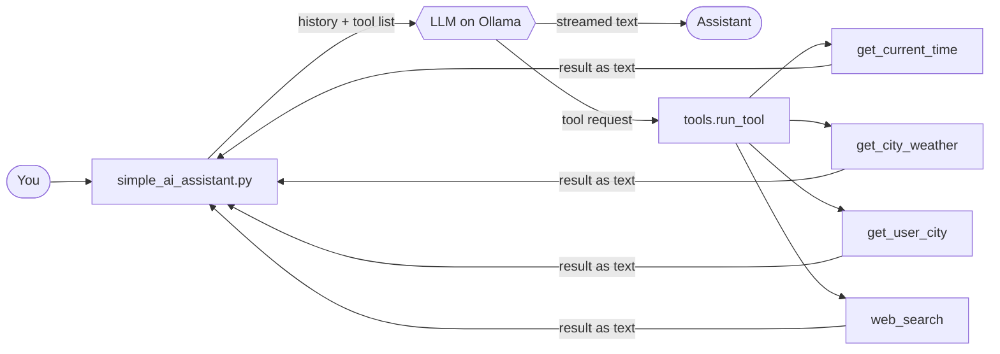

<div align="center">


**A terminal AI assistant that runs fully on your own machine. It streams its replies, calls tools, and chains them, with no paid API key and no agent framework.**

</div>

<br/>

## 🚀 What is this?

A **local AI assistant built from scratch in Python**. It talks to a model running on [Ollama](https://ollama.com) through the OpenAI-compatible API, so all the logic is plain Python you can read.

It remembers the conversation, follows a system prompt, streams the answer token by token, and can use tools **in several steps**. For example, it can search the web, read the results, and then answer with source links.

> 🎬 I am building this while learning from the **Advanced AI** playlist by [codestorywithMIK](https://www.youtube.com/@codestorywithMIK). The core idea (a tool-calling agent loop on Ollama) follows that series, and I have extended it with streaming, web search and Ctrl+C handling. See [Acknowledgements](#-acknowledgements).

> [!NOTE]
> 🌱 **Work in progress.** This project is still growing. Planned next: RAG, persistent memory and more tools.

<br/>

## ✨ Features

| | Feature | Details |
|---|---|---|
| 🌊 | **Streaming replies** | Text appears token by token instead of after a long wait |
| 🧩 | **Streamed tool-call assembly** | Tool names and arguments arrive in pieces and are stitched together before running |
| 🧠 | **Conversation memory** | The full history is sent on every call, because the model has no memory of its own |
| 🎭 | **System prompt** | Tells the model to answer general questions directly and search only when asked for current information |
| 🔧 | **Tool calling** | Tools are described with a JSON schema and executed by our own code |
| 🔗 | **Chained tool calls** | A loop with a step limit (`MAX_STEPS = 5`) so it can never run forever |
| 🌐 | **Web search** | `web_search` uses DuckDuckGo and returns the top 5 results with URLs |
| 🛡️ | **Safe errors** | Tool failures go back to the model as text, so the program does not crash |
| ⛔ | **Ctrl+C handling** | Interrupting a reply stops it and removes that turn from the history |
| 🪲 | **Debug trace** | Grey logs switched on with `DEBUG=True` |

<br/>

## 🧩 How it works

The model **never runs code**. It only asks for a tool. Our Python code runs it, sends the result back, and the loop repeats until the model answers in plain text.



<details>
<summary><b>📖 The loop in words (click to expand)</b></summary>

1. We send the conversation plus the list of tools to the model.
2. The reply streams in. If it contains text, it is printed live. If it contains a **tool request**, the pieces are collected until complete.
3. Our code runs the real function and sends the result back with the `tool` role.
4. The model reads the result and either asks for another tool or writes the final answer.

This repeats up to `MAX_STEPS` times per question. If the limit is reached, the assistant says so instead of looping forever.

</details>

<br/>

## 🛠️ Available tools

| Tool | What it does |
|---|---|
| `get_current_time` | Returns the current local date and time |
| `get_city_weather(city)` | One-line weather from the free `wttr.in` service |
| `get_user_city` | Returns the user's city (hard-coded demo value) |
| `web_search(query)` | Searches the web with DuckDuckGo and returns titles, URLs and snippets |

<br/>

## ⚡ Quick start

**Prerequisites:** Python 3.10+ and [Ollama](https://ollama.com/download) installed and running.

```bash
# 1. Download the model
ollama pull qwen3:4b

# 2. Get the code
git clone https://github.com/Vikal-Dubey/ai-assistant.git
cd ai-assistant

# 3. Create and activate a virtual environment
python -m venv .venv
# Windows:    .venv\Scripts\activate
# Mac/Linux:  source .venv/bin/activate

# 4. Install dependencies
pip install openai python-dotenv requests ddgs

# 5. Create your settings file (see Configuration below)

# 6. Run
python simple_ai_assistant.py
```

Type `exit`, `quit`, `bye` or `goodbye` to stop. Press `Ctrl+C` during a reply to interrupt it.

> 💡 On Windows, run these commands in **PowerShell**. Ollama usually starts in the background after installation, so you do not need to run `ollama serve` yourself.

<br/>

## ⚙️ Configuration

Create a `.env` file in the project root:

```env
BASE_URL=http://127.0.0.1:11434/v1
API_KEY=ollama
MODEL=qwen3:4b
DEBUG=True
```

| Name | Meaning |
|---|---|
| `BASE_URL` | OpenAI-compatible endpoint. For Ollama: `http://127.0.0.1:11434/v1` |
| `API_KEY` | Required by the client, ignored by Ollama. Any dummy value works |
| `MODEL` | Exact model name from `ollama list`. It must support tool calling |
| `DEBUG` | Set to `True` (capital T) to show the grey debug trace |

> 💡 Rules for `.env`: `NAME=value`, no spaces around `=`, no quotes. Restart the program after editing it. Keep `.env` out of Git.

<br/>

## ➕ Add your own tool

Three changes in `tools.py`, and the chat loop stays untouched:

1. ✍️ Write the Python function.
2. 📋 Add its description to the `TOOLS` list (name, description, parameters, `required`).
3. 🗺️ Register it in `FUNCTION_NAME_TO_FUNCTION`.

> The `description` matters: a small model reads it to decide **when** to use the tool. For example, `web_search` says to use it only when the user asks to search or wants the latest information.

<br/>

## 🧪 Code snippets

The `Code_Snippets/` folder holds the small experiments the main program is built from:

| File | Purpose |
|---|---|
| `stream_test.py` | Streams a plain text answer from the model |
| `stream_tool_test.py` | Streams a response with tools attached and assembles the tool calls |

<br/>

## 📁 Project structure

```text
ai-assistant/
├── simple_ai_assistant.py    chat loop, memory, streaming and the agent loop
├── tools.py                  tool functions, TOOLS schema, run_tool()
├── Utilities/
│   └── utilities.py          grey debug log() helper
├── Code_Snippets/
│   ├── stream_test.py        streaming text experiment
│   └── stream_tool_test.py   streaming tool-call experiment
└── .env                      your local settings (not committed)
```

<br/>

## ⚠️ Honest limitations

- Memory is kept in RAM and is lost when the program exits.
- The history is not trimmed, so very long chats can exceed the model's context window.
- Small local models like `qwen3:4b` can call a tool when they should not. The system prompt and tool descriptions reduce this but cannot guarantee it.
- `get_user_city` returns a hard-coded demo value.
- The weather and web search tools need internet. `wttr.in` and DuckDuckGo can be slow or unavailable.
- Pressing `Ctrl+C` at the input prompt exits the program.
- Tool output is not treated as untrusted, so only read-only tools are included.

<br/>

## 🗺️ Roadmap

- [ ] Persistent memory across sessions
- [ ] Trim or summarize long histories
- [ ] RAG over local documents
- [ ] More tools
- [ ] Ask the user for their city instead of the demo value

<br/>

## 🙏 Acknowledgements

This project is a learning project. I am following the **Advanced AI** playlist by [codestorywithMIK](https://www.youtube.com/@codestorywithMIK), which builds a local tool-calling agent with Python and Ollama step by step. The overall approach and the structure of this README come from his series. Everything here was written and extended by me while learning, and any mistakes are mine. If you are new to these ideas, I recommend watching his playlists.

<br/>

<div align="center">

### 🙌 If this helped you, a ⭐ is appreciated.

Built by [Vikal Dubey](https://github.com/Vikal-Dubey)


</div>